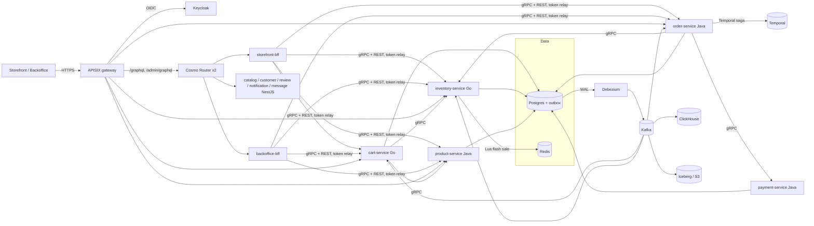
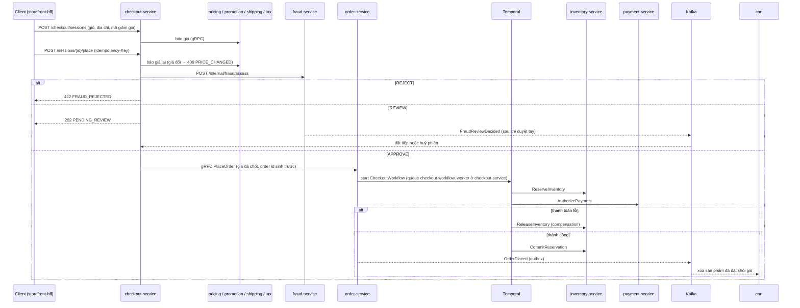

# Tổng quan kiến trúc

## Luồng checkout ([ADR 0012](../adr/0012-checkout-pricing-fraud-recommendation.md))

Chi tiết từng quyết định: `docs/adr`. Contract: `api/proto` (gRPC + event), `api/asyncapi`, `api/openapi`, `api/graphql`.
